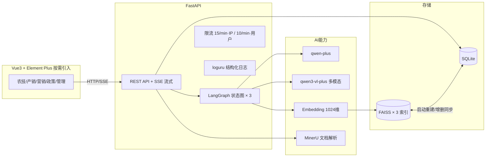

# 智农通 · AI 助农服务平台

面向农户、采购商、管理员三类角色的一站式农业 AI 服务平台：**农技问答（拍照诊断）、产销智能匹配、AIGC 营销文案、惠农政策 RAG 问答**，全部能力流式输出。

    

## 功能特性

| 模块 | 能力 | 技术要点 |
|---|---|---|
| 农技 AI 助手 | 多轮对话 + 病虫害拍照诊断 | LangGraph 条件路由（文本/多模态双分支），qwen3-vl-plus 视觉模型 |
| 产销对接 | 供应/求购发布，双向智能匹配 | 文本 embedding + FAISS Top-5 召回，元数据 DB 层过滤 |
| 营销工具 | 种草文案 / 直播话术 / 短视频脚本生成 | 三模板 prompt 工程 + 广告法约束，SSE 流式 |
| 政策问答 | 惠农政策 RAG 咨询 | MinerU 文档解析（OCR/表格线性化）→ 分块向量化 → FAISS 检索 → 带出处生成，库外拒答 |
| 管理后台 | 统计看板 / 用户管理 / 内容治理 / 知识库维护 | RBAC、账号禁用即时生效、内容强制下架 |

## 系统架构



**双存储向量架构**：SQLite BLOB 持久化 + FAISS `IndexIDMap2(IndexFlatIP)` 内存索引（归一化内积 = 余弦相似度），启动全量重建、业务增删改实时同步；品类/状态/惰性过期等元数据在检索后回 DB 过滤，上下架零索引同步成本。

## 技术亮点

- **LangGraph 编排**：3 张状态图（农技多模态条件路由 / 营销单节点 / 政策"检索→生成"两节点），`astream_events` 统一事件流，全端 SSE 逐字输出
- **完整 RAG 链路**：PDF（含扫描件 OCR）→ Markdown（表格线性化）→ `RecursiveCharacterTextSplitter`（500/50）→ 向量化入库 → FAISS Top-K → 生成注明文档出处，知识库外问题拒答不编造
- **安全设计**：JWT + bcrypt、三角色 RBAC、水平越权（IDOR）防护（资源归属校验 + 404 不暴露存在性）、账号禁用每请求校验即时生效、限流 key 中 token 哈希化防日志泄露
- **分级限流**：认证接口 15 次/分钟（IP，防爆破）；LLM 接口 10 次/分钟（用户级，防 token 滥刷）
- **性能优化**：Element Plus 按需引入（unplugin 双插件），构建主包 1240KB → 410KB（**-67%**）；命令式 API 样式兜底等三处踩坑修复
- **质量保障**：三轮回归测试 **75 项用例 100% 通过**（含 9 项水平越权矩阵、SSE 流式分片断言、边界值与越权矩阵）

## 快速开始

### 环境要求

- Python 3.10+ / Node.js 18+
- API Keys：[DashScope（通义千问）](https://dashscope.console.aliyun.com/)、[MinerU](https://mineru.net)（仅政策文档 PDF 解析需要）

### 启动

```bash
# 1. 后端
cd backend
python -m venv .venv
.venv\Scripts\pip install -r requirements.txt
copy .env.example .env   # 填入你的 API Key
.venv\Scripts\python -m uvicorn app.main:app --port 8000

# 2. 前端
cd frontend
npm install
npm run dev   # http://localhost:5173
```

Windows 用户可直接双击项目根目录 `一键启动.bat`。

### 演示账号

| 角色 | 用户名 | 密码 | 功能入口 |
|---|---|---|---|
| 农户 | farmertest | 123456 | 农技问答、发布供应、营销工具 |
| 采购商 | buyertest | 123456 | 发布求购、AI 货源匹配 |
| 管理员 | admin | 123456 | 用户管理、知识库、内容治理 |

> 首次启动后通过注册接口创建 admin（需在 `auth.py` 临时放开，或直接 SQL 插入后 bcrypt 哈希）——详见 `backend/app/api/auth.py`

## 项目结构

```
├── backend/
│   ├── app/
│   │   ├── api/            # 路由层：auth / agritech / market / marketing / policy / admin ...
│   │   ├── services/       # 业务层：graphs(LangGraph×3) / rag / matcher / mineru / embedding / vector_index
│   │   ├── models.py       # SQLAlchemy ORM
│   │   ├── schemas.py      # Pydantic 校验
│   │   ├── rate_limit.py   # slowapi 限流
│   │   └── logger.py       # loguru 日志
│   └── scripts/            # 回归测试脚本（75 用例）
├── frontend/
│   └── src/
│       ├── views/          # agritech / market / marketing / policy / admin
│       ├── api/            # axios + SSE 封装
│       └── utils/sse.js    # SSE 流式解析
└── docs/                   # 系统设计文档
```

## 测试

```bash
cd backend
.venv\Scripts\python scripts\test_full_regression.py   # 57 项核心回归
.venv\Scripts\python scripts\test_blind_spots.py       # 18 项盲区排查（IDOR/隔离/边界）
```

覆盖认证、会话、农技 SSE、多模态诊断、产销增删改与双向匹配、营销三类型生成、政策 RAG 命中与拒答、管理后台权限矩阵、水平越权、限流触发等。

## License

MIT
